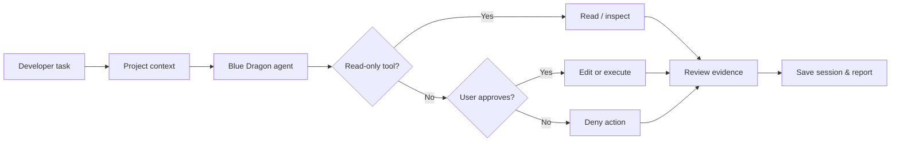

<p align="center">
  
</p>

<h1 align="center">BLUE DRAGON</h1>

<p align="center"><strong>An open-source, cross-platform AI coding agent built with Rust.</strong></p>

<p align="center"><em>Inspect the project. Plan with context. Review every change.</em></p>

<p align="center">
  <a href="Cargo.toml"></a>
  <a href="LICENSE"></a>
  <a href="https://github.com/khdertaysh1/khdertaysh1-blue-dragon-agent/actions/workflows/ci.yml"></a>
  
</p>

<p align="center">
  <a href="#quick-start">Get started</a> ·
  <a href="#the-dragon-mind">Explore the agent</a> ·
  <a href="#terminal-preview">Animated preview</a> ·
  <a href="docs/SHOWCASE.md">Visual gallery</a> ·
  <a href="#capabilities">Capabilities</a> ·
  <a href="#human-in-control">Safety</a> ·
  <a href="#roadmap">Roadmap</a>
</p>

> [!IMPORTANT]
> **Developer preview: `v0.5.0-alpha.2`.** Includes real browser control through local CDP or a paired Firefox/Chromium extension, and Blue Free automatic free-model rotation. Pasting a URL now prepares a local browser and collects an initial review automatically; Android device validation and Firefox signing remain pending. This is not full feature parity with AlphaCode. See [browser setup](docs/BROWSER.md), [rotation rules](docs/FREE_ROTATION.md) and [workbench limits](docs/WORKBENCH.md).

## The Dragon Mind

<div align="center">
  
  <sub>Animated neural workflow: travelling signals, rotating orbit and neural pulses. Motion is decorative; the agent runs in Rust.</sub>
</div>

Blue Dragon is designed around a simple engineering loop: **understand → act with approval → verify → explain**. Unlike an opaque "autopilot", writes and subprocess commands are presented for explicit user approval. The project is independently developed; a small adapted MIT protocol component is credited in [third-party notices](third_party/NOTICE.md).

## Capabilities

| Area | What is currently available |
|:--|:--|
| **AI providers** | Keyless free gateway, saved provider/model selection, OpenRouter free catalog, local Ollama, OpenAI-compatible and native Anthropic |
| **Workspace intelligence** | Bounded project map, file listing, file reading, line-range reads and string search |
| **Code changes** | Targeted exact-match edit and full text-file write, both behind diff approval |
| **Git inspection** | Working-tree status and unstaged diff |
| **Execution** | Commands with explicit approval, timeout and bounded output |
| **Memory** | Locally saved JSON sessions, resume by ID or latest |
| **Skills** | Opt-in local Markdown workflows, without running bundled scripts |
| **Safety controls** | `--read-only`, protected-path checks and deny-by-default noninteractive approvals |
| **Terminal** | Full-screen `tui`, streamed responses, approval overlay, cancellation, plan pane; CLI `chat`, `run` and diagnostics |
| **MCP** | Opt-in stdio servers, approved launch/discovery/tool calls; no auto-execution of repository config |
| **Planning & evidence** | Saved task steps, bounded tool-action report, resume |
| **Network & files** | Approved text web fetch, directory creation, file metadata |
| **Real browser** | Local CDP or own paired Firefox/Chromium extension: page DOM, click/fill, JavaScript, network metadata, console, bounded source and local screenshots |
| **Blue Free** | Keyless verified free pool, visible bounded automatic rotation; concrete model choices stay pinned |

<details>
<summary><b>See all 15 built-in agent tools</b></summary>

```text
list_files     read_file      read_lines    search_files
project_map    git_status     git_diff      edit_file
write_file     run_command    update_plan   create_directory
file_info      web_fetch      browser
```

Every write or command requires a per-action approval. Tool availability depends on the local environment.

</details>

## Terminal Preview

<div align="center">
  <a href="assets/neural-console-preview.gif">
    
  </a>
  <br />
  <sub><strong>Animated product concept</strong> — not a recorded live session or a claim of current runtime functionality. Click to open the animation.</sub>
</div>

Run the actual terminal with `blue-dragon tui`. It includes a conversation, live output, tool progress and approval modal. The artwork above remains an illustration; it is not a captured runtime session. See [workbench documentation](docs/WORKBENCH.md).

<details>
<summary><strong>Explore the static terminal mockup and the design notes</strong></summary>

<br />
<p align="center">
  
</p>

The demo is deliberately illustrative. Commands and results are sample text; they are **not** captured execution evidence. The agent's real, tested capabilities are listed in the table above. See the [visual identity and motion notes](docs/VISUAL_IDENTITY.md) for the editable asset inventory.

</details>

## Browser and automatic free models

After installation, run `blue-dragon 'https://example.com'`, or paste a URL into chat/TUI. The agent prepares the browser and collects DOM, forms, JavaScript indicators, network and console before model analysis. Relevant URL inputs receive at most two benign DOM execution checks, with observed proof separated from static hints. Termux first use installs official Chromium automatically and runs it in the background unless X11 is available; no ADB setup is required for this path. Initial inspection reads need no individual confirmations; further interactions still require approval. See [URL inspection and platform limits](docs/URL_INSPECTION.md). Physical Android validation remains pending.

Use `/model blue-free` for automatic free-model rotation and `/rotation` for its status. Firefox extension pairing and advanced Chrome ADB attachment remain available: [browser instructions](docs/BROWSER.md), [free routing policy](docs/FREE_ROTATION.md).

## Quick Start

**Termux / Android ARM64: install a ready-made binary. No Rust, Git clone or compilation required.**

```bash
pkg install curl jq -y &&
curl -fsSL https://raw.githubusercontent.com/khdertaysh1/khdertaysh1-blue-dragon-agent/main/scripts/install.sh | bash
```

Then run from the project you want to inspect:

```bash
blue-dragon --version
blue-dragon --provider free tui
```

Run the **same installer command to update**. It selects a published release for your device, verifies SHA256 and the executable's version, then replaces the binary atomically. Failed downloads/checks leave the installed binary intact; the previous binary is saved for rollback. Sessions, settings and source checkouts are untouched. Installation needs `curl`, `jq` and a SHA256 utility, not a model API key. Only complete published releases are selected, including alpha prereleases.

See [installation, supported systems, rollback and developer source builds](docs/INSTALL.md). [Published releases](https://github.com/khdertaysh1/khdertaysh1-blue-dragon-agent/releases) contain persistent downloads and checksums; Actions artifacts are temporary developer outputs.

This uses **Kilo Gateway's public free models**, the same gateway used by AlphaCode's free lane. A fresh install without saved configuration or provider keys selects **Blue Free** (Kilo automatic free route with bounded client rotation). Type `/models` for a searchable terminal picker of individual zero-priced, tool-capable models. Use arrows, type to filter, and Enter to select/save. No account, API key, wallet or paid fallback is bundled. Kilo/upstreams may log prompts and tool results and use them for improvement; use public or synthetic data. Service quotas and model availability are externally controlled.

Select and save a provider from the terminal:

```text
/models
/model blue-free
/rotation
/model kilo cohere/north-mini-code:free
/model jarvis
/model ollama YOUR_INSTALLED_MODEL
```

Or use `blue-dragon model free` before launching. `/models refresh` updates Kilo's keyless free catalog. `/models openrouter` separately lists OpenRouter free models, which require your own `OPENROUTER_API_KEY`. Switching changes where subsequent conversation context is sent. See [model setup and live validation](docs/MODELS.md).

To use a hosted, OpenAI-compatible endpoint with your own key:

```bash
export BLUE_DRAGON_API_KEY="YOUR_API_KEY"
export BLUE_DRAGON_MODEL="YOUR_TOOL_CALLING_MODEL"
./target/release/blue-dragon --root . tui
```

Prefer to try inspection before connecting AI? The project map and diagnostics run locally:

```bash
./target/release/blue-dragon map
./target/release/blue-dragon skills
./target/release/blue-dragon doctor
```

<details>
<summary><b>Windows PowerShell setup</b></summary>

```powershell
$env:BLUE_DRAGON_API_KEY = "YOUR_API_KEY"
$env:BLUE_DRAGON_MODEL = "YOUR_TOOL_CALLING_MODEL"
.\target\release\blue-dragon.exe doctor
.\target\release\blue-dragon.exe chat
```

</details>

<details>
<summary><b>Anthropic Claude native API</b></summary>

```bash
export BLUE_DRAGON_BASE_URL="https://api.anthropic.com/v1"
export BLUE_DRAGON_MODEL="YOUR_CLAUDE_MODEL_ID"
export ANTHROPIC_API_KEY="YOUR_ANTHROPIC_API_KEY"
./target/release/blue-dragon chat
```

The protocol adapter is unit-tested, but live credentials have not been exercised in CI.

</details>

<details>
<summary><b>Local, OpenAI-compatible model endpoint</b></summary>

```bash
BLUE_DRAGON_BASE_URL=http://127.0.0.1:11434/v1 \
BLUE_DRAGON_MODEL=YOUR_TOOL_CALLING_MODEL \
./target/release/blue-dragon chat
```

Choose a model with compatible function calling. A keyless free gateway is preconfigured; no model weights or paid credentials are bundled.

</details>

<details>
<summary><b>Developer source build on Termux / Android</b></summary>

```bash
pkg install git rust clang pkg-config
git clone https://github.com/khdertaysh1/khdertaysh1-blue-dragon-agent.git
cd khdertaysh1-blue-dragon-agent
cargo build --locked --release
./target/release/blue-dragon doctor
```

Termux builds are device and package dependent; Linux CI success does not establish Android compatibility.

</details>

## How It Works



For module boundaries, provider integration and tool definitions, see [Architecture](docs/ARCHITECTURE.md).

## Human in Control

Blue Dragon is **not a sandbox**. Approved commands run on your machine; inspect each proposal before typing `y`. Files and tool transcripts can be sent to the configured model service. Secrets, excluded paths and size limits have safety checks, but cannot guarantee isolation from a hostile local workspace.

```bash
./target/release/blue-dragon --root . --read-only run "Review the project structure"
./target/release/blue-dragon --root . --resume latest chat
```

[Read the security model](SECURITY.md) · [Review architecture](docs/ARCHITECTURE.md)

## Roadmap

<details>
<summary><b>Delivered — Agent foundation</b></summary>

- [x] Rust CLI and OpenAI-compatible tool calling
- [x] Native Anthropic API conversion adapter
- [x] Ten workspace tools, diff review and explicit approvals
- [x] Project mapping, skills and session resume
- [x] Cross-platform CI on Windows, Linux and macOS

</details>

<details>
<summary><b>In progress — A more capable developer experience</b></summary>

- [x] Integrated full-screen TUI, streaming, task plans and opt-in stdio MCP
- [ ] Physical-device terminal testing and wider MCP compatibility
- [ ] Better patch-oriented edits, context compaction and richer code navigation
- [ ] Reliable release packaging and Termux-specific verification

</details>

<details>
<summary><b>Planned — Beyond the terminal</b></summary>

- [x] Browser CDP/extension transport and bounded automatic free-model rotation
- [ ] Physical Android browser verification and signed Firefox distribution
- [ ] Desktop automation, remote MCP transports and isolated worktrees
- [ ] Parallel agents, evidence-driven verification and security analysis modules
- [ ] Optional native desktop interface and reproducible performance benchmarks

</details>

## Development & Contributing

```bash
cargo fmt --all -- --check
cargo test --all-targets
cargo clippy --all-targets -- -D warnings
cargo build --locked --release
```

Read the [design notes](docs/VISUAL_IDENTITY.md), [feature-parity tracker](docs/ALPHACODE_PARITY.md), or open an issue with a reproducible bug. Contributions should preserve explicit approval, clear evidence and truthful documentation.

<div align="center">
  
  <br/>
  <sub>BLUE DRAGON · Rust · MIT License · Independent open-source project</sub>
</div>
