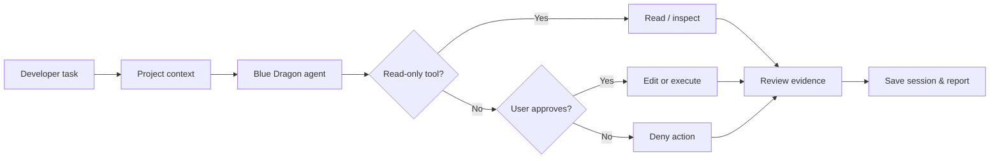

<div align="center">


<br/>

# BLUE DRAGON

**An open-source, cross-platform AI coding agent built with Rust.**

*Inspect the project. Plan with context. Review every change.*

[](Cargo.toml)
[](LICENSE)
[](https://github.com/khdertaysh1/khdertaysh1-blue-dragon-agent/actions/workflows/ci.yml)


[**Get started**](#-quick-start) · [**Explore the agent**](#-the-dragon-mind) · [**Terminal preview**](#-terminal-preview) · [**Capabilities**](#-capabilities) · [**Safety**](#-human-in-control) · [**Roadmap**](#-roadmap)

</div>

> [!IMPORTANT]
> **Developer preview: `v0.2.0-alpha.1` on `main`.** Blue Dragon has a working, testable agent core, but is **not** feature-equivalent to AlphaCode, Codex CLI or Claude Code. The full-screen TUI is in [experimental PR #1](https://github.com/khdertaysh1/khdertaysh1-blue-dragon-agent/pull/1), not in the current `main` binary. Browser automation, MCP and multi-agent orchestration are not implemented yet.

## ✧ The Dragon Mind

<div align="center">
  
  <sub>Original animated SVG concept. Motion is decorative; the real agent runs in Rust.</sub>
</div>

Blue Dragon is designed around a simple engineering loop: **understand → act with approval → verify → explain**. Unlike an opaque "autopilot", writes and subprocess commands are presented for explicit user approval. The project is independently authored and is not a fork of AlphaCode.

## ✦ Capabilities

| Area | What is currently available |
|:--|:--|
| **AI providers** | OpenAI-compatible tool calling, plus a native Anthropic Messages adapter (unit-tested) |
| **Workspace intelligence** | Bounded project map, file listing, file reading, line-range reads and string search |
| **Code changes** | Targeted exact-match edit and full text-file write, both behind diff approval |
| **Git inspection** | Working-tree status and unstaged diff |
| **Execution** | Commands with explicit approval, timeout and bounded output |
| **Memory** | Locally saved JSON sessions, resume by ID or latest |
| **Skills** | Opt-in local Markdown workflows, without running bundled scripts |
| **Safety controls** | `--read-only`, protected-path checks and deny-by-default noninteractive approvals |
| **Terminal** | CLI `chat`, `run` and diagnostics; [experimental full-screen TUI in PR #1](https://github.com/khdertaysh1/khdertaysh1-blue-dragon-agent/pull/1) |

<details>
<summary><b>See all 10 current agent tools</b></summary>

```text
list_files     read_file      read_lines    search_files
project_map    git_status     git_diff      edit_file
write_file     run_command
```

Every write or command requires a per-action approval. Tool availability depends on the local environment.

</details>

## ✧ Terminal Preview

<div align="center">
  <a href="https://github.com/khdertaysh1/khdertaysh1-blue-dragon-agent/pull/1">
    
  </a>
  <sub>Illustrative mockup, not a captured live session. Click to inspect the experimental TUI branch.</sub>
</div>

The prototype TUI adds a full-screen conversation view, tool-step feedback and an approval dialog. The **stable `main` branch currently uses the standard CLI**.

## ⚡ Quick Start

Requires a **Rust toolchain** and a model endpoint supporting tool/function calling. Git is recommended.

```bash
git clone https://github.com/khdertaysh1/khdertaysh1-blue-dragon-agent.git
cd khdertaysh1-blue-dragon-agent
cargo build --release
./target/release/blue-dragon doctor
```

Start the agent with a hosted, OpenAI-compatible endpoint:

```bash
export BLUE_DRAGON_API_KEY="YOUR_API_KEY"
export BLUE_DRAGON_MODEL="YOUR_TOOL_CALLING_MODEL"
./target/release/blue-dragon --root . chat
```

Prefer to try inspection before connecting AI? The project map and diagnostics run locally:

```bash
./target/release/blue-dragon map
./target/release/blue-dragon skills
./target/release/blue-dragon doctor
```

<details>
<summary><b>Windows PowerShell setup</b></summary>

```powershell
$env:BLUE_DRAGON_API_KEY = "YOUR_API_KEY"
$env:BLUE_DRAGON_MODEL = "YOUR_TOOL_CALLING_MODEL"
.\target\release\blue-dragon.exe doctor
.\target\release\blue-dragon.exe chat
```

</details>

<details>
<summary><b>Anthropic Claude native API</b></summary>

```bash
export BLUE_DRAGON_BASE_URL="https://api.anthropic.com/v1"
export BLUE_DRAGON_MODEL="YOUR_CLAUDE_MODEL_ID"
export ANTHROPIC_API_KEY="YOUR_ANTHROPIC_API_KEY"
./target/release/blue-dragon chat
```

The protocol adapter is unit-tested, but live credentials have not been exercised in CI.

</details>

<details>
<summary><b>Local, OpenAI-compatible model endpoint</b></summary>

```bash
BLUE_DRAGON_BASE_URL=http://127.0.0.1:11434/v1 \
BLUE_DRAGON_MODEL=YOUR_TOOL_CALLING_MODEL \
./target/release/blue-dragon chat
```

Choose a model with compatible function calling. **No free hosted AI provider is bundled.**

</details>

<details>
<summary><b>Termux / Android (not yet verified in CI)</b></summary>

```bash
pkg install git rust clang pkg-config
git clone https://github.com/khdertaysh1/khdertaysh1-blue-dragon-agent.git
cd khdertaysh1-blue-dragon-agent
cargo build --release
./target/release/blue-dragon doctor
```

Termux builds are device and package dependent; Linux CI success does not establish Android compatibility.

</details>

## ◇ How It Works



For module boundaries, provider integration and tool definitions, see [Architecture](docs/ARCHITECTURE.md).

## ◈ Human in Control

Blue Dragon is **not a sandbox**. Approved commands run on your machine; inspect each proposal before typing `y`. Files and tool transcripts can be sent to the configured model service. Secrets, excluded paths and size limits have safety checks, but cannot guarantee isolation from a hostile local workspace.

```bash
./target/release/blue-dragon --root . --read-only run "Review the project structure"
./target/release/blue-dragon --root . --resume latest chat
```

[Read the security model](SECURITY.md) · [Review architecture](docs/ARCHITECTURE.md)

## 🚀 Roadmap

<details>
<summary><b>Delivered — Agent foundation</b></summary>

- [x] Rust CLI and OpenAI-compatible tool calling
- [x] Native Anthropic API conversion adapter
- [x] Ten workspace tools, diff review and explicit approvals
- [x] Project mapping, skills and session resume
- [x] Cross-platform CI on Windows, Linux and macOS

</details>

<details>
<summary><b>In progress — A more capable developer experience</b></summary>

- [ ] Merge and harden full-screen TUI (currently in [PR #1](https://github.com/khdertaysh1/khdertaysh1-blue-dragon-agent/pull/1))
- [ ] Model token streaming, better patch-oriented edits and richer code navigation
- [ ] Reliable release packaging and Termux-specific verification

</details>

<details>
<summary><b>Planned — Beyond the terminal</b></summary>

- [ ] Browser automation, MCP client integrations and isolated worktrees
- [ ] Parallel agents, evidence-driven verification and security analysis modules
- [ ] Optional native desktop interface and reproducible performance benchmarks

</details>

## ◇ Development & Contributing

```bash
cargo fmt --all -- --check
cargo test --all-targets
cargo clippy --all-targets -- -D warnings
cargo build --release
```

Read the [design notes](docs/VISUAL_IDENTITY.md), [feature-parity tracker](docs/ALPHACODE_PARITY.md), or open an issue with a reproducible bug. Contributions should preserve explicit approval, clear evidence and truthful documentation.

<div align="center">
  
  <br/>
  <sub>BLUE DRAGON · Rust · MIT License · Independent open-source project</sub>
</div>
