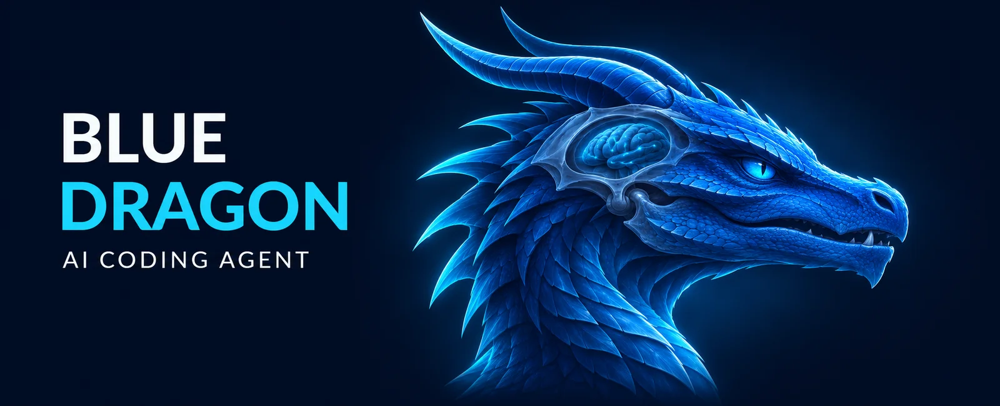
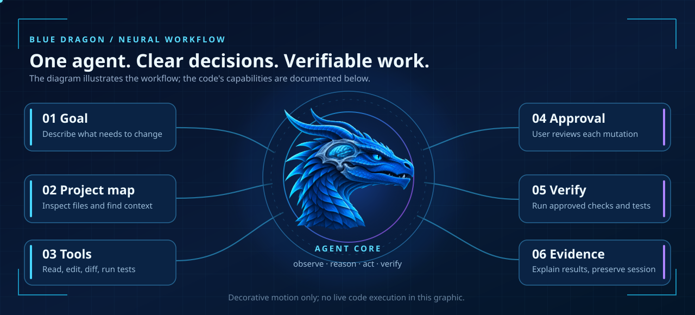
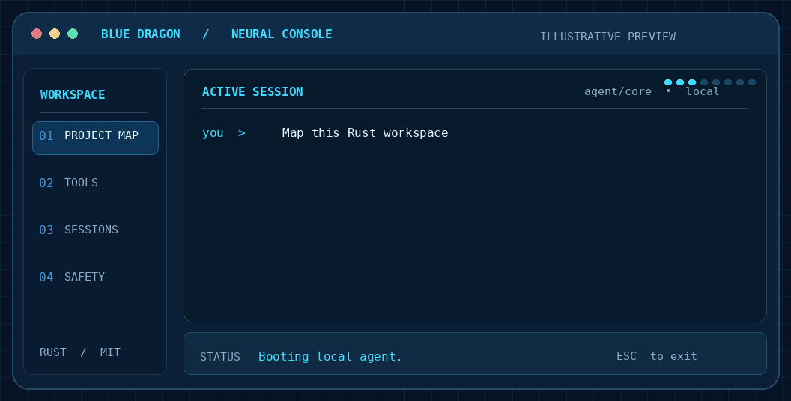

# Blue Dragon visual showcase

> **Design illustrations — not runtime screenshots.** Blue Dragon is an independent Rust coding agent. The illustrations below explain its interface direction and engineering principles; they do not assert that planned functionality has shipped.

## 01 · Identity

The dragon stands for deliberate execution; the circuit brain stands for project context and tool orchestration. The visual language is original, not borrowed from another project's branding.

## 02 · The Dragon Mind

The diagram shows a *conceptual* workflow from project inspection to approved actions. CSS/SMIL motion may be disabled by the GitHub image renderer; the diagram remains legible as a static illustration.

## 03 · Animated console concept

This looping animation is **not a screen recording**. It uses sample commands, sample output and a proposed change modal to show the intended terminal experience. The current Rust CLI provides project-map commands and per-action approval; the full-screen TUI is tracked in [PR #1](https://github.com/khdertaysh1/khdertaysh1-blue-dragon-agent/pull/1).

## 04 · Honest capability status

The [README](../README.md#capabilities) lists implemented functions, while the [roadmap](../README.md#roadmap) tracks future integration work. Interactive web features are not embedded in GitHub markdown; native expandable details, Mermaid diagrams and linked visuals provide GitHub-supported exploration.

## Reproduction and accessibility

The image is an optimized 12-frame GIF (1056 × 536) and includes a visible **ILLUSTRATIVE PREVIEW** label. Its source is a simple Pillow drawing script in the development workspace; text content is intentionally hypothetical. Prefer real screenshots as the project matures, and never use this animation as a benchmark result.
