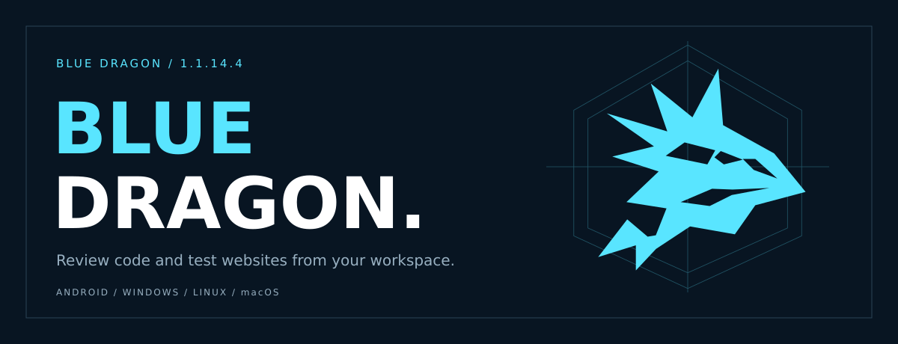
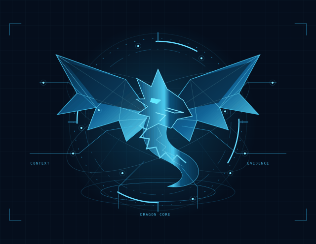
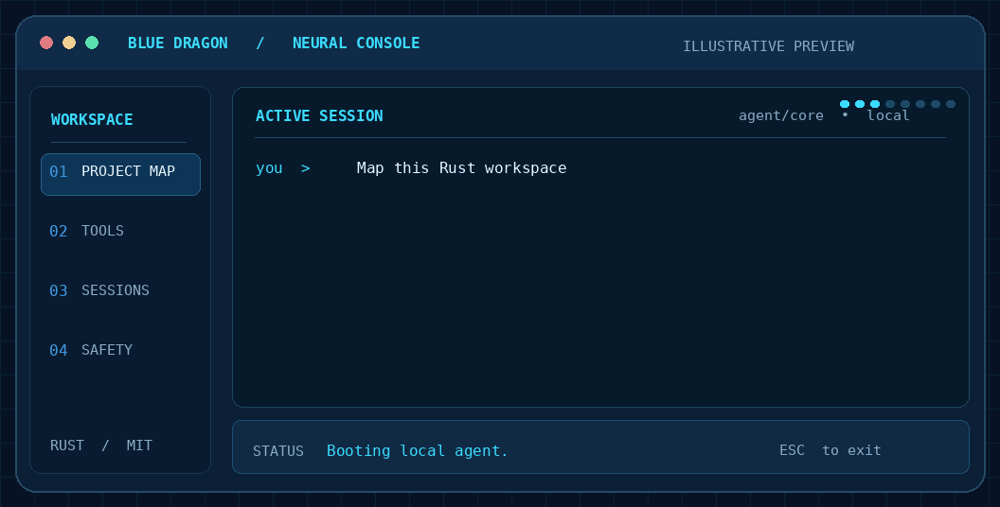

# Blue Dragon visual showcase

> **Design illustrations — not runtime screenshots.** Blue Dragon is an independent Rust coding agent. The illustrations below explain its interface direction and engineering principles; they do not assert that planned functionality has shipped.

## 01 · Identity

The dragon stands for deliberate execution; the surrounding circuit motifs stand for project context and tool orchestration. The visual language is original, not borrowed from another project's branding.

## 02 · The Dragon

The Abyss dragon is exported as a 24-frame GIF. This is decorative identity artwork, not live activity. [Still alternative](../assets/abyss-dragon.svg) and [terminal adaptation](ABYSS_IDENTITY.md) explain accessibility and platform limits.

## 03 · Animated console concept

This looping animation is **not a screen recording**. It uses sample commands, sample output and a proposed change modal to show the intended terminal experience. The Rust agent provides project-map commands and per-action approval; the actual full-screen TUI is available through `blue-dragon tui` in the workbench revision.

## 04 · Honest capability status

The [README](../README.md#capabilities) lists implemented functions, while the [roadmap](../README.md#roadmap) tracks future integration work. Interactive web features are not embedded in GitHub markdown; native expandable details, Mermaid diagrams and linked visuals provide GitHub-supported exploration.

## Reproduction and accessibility

The image is an optimized 12-frame GIF (1056 × 536) and includes a visible **ILLUSTRATIVE PREVIEW** label. Its source is a simple Pillow drawing script in the development workspace; text content is intentionally hypothetical. Prefer real screenshots as the project matures, and never use this animation as a benchmark result.
